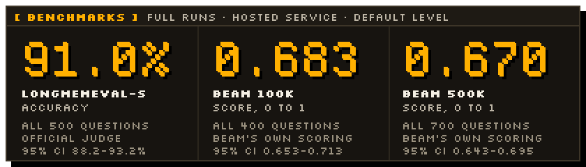

<p align="center">
  <a href="https://recallmem.dev">
    <picture>
      <source media="(prefers-color-scheme: dark)" srcset=".github/assets/hero-dark.svg">
      <source media="(prefers-color-scheme: light)" srcset=".github/assets/hero-light.svg">
      
    </picture>
  </a>
</p>

<p align="center">
  <a href="https://recallmem.dev"><b>Website</b></a> ·
  <a href="https://recallmem.dev/docs"><b>Docs</b></a> ·
  <a href="https://recallmem.dev/evals"><b>Evals</b></a> ·
  <a href="https://recallmem.dev/guides"><b>Guides</b></a> ·
  <a href="https://app.recallmem.dev"><b>Get an API key</b></a>
</p>

<p align="center">
  <a href="LICENSE.md"></a>
  <a href="https://www.npmjs.com/package/@recall-memory/sdk"></a>
  <a href="https://pypi.org/project/recall-mem/"></a>
  <a href="https://github.com/recallmem/recall/actions/workflows/ci.yml"></a>
</p>

**Your agents forget. Recall keeps receipts.** Recall is long-term memory for AI agents that talk to the
same people again. Send it the conversation; in the background it works out what is true about
each person, keeps a **dated, cited record** of it, and retires facts that stop being true (when
Alice moves from London to New York, the old address is closed, not contradicted). Ask it a
question and it answers from that record in a single model call, with its sources, or hands you the
context to put in your own prompt. Use the hosted API at [recallmem.dev](https://recallmem.dev)
(hosted in Frankfurt), or run the server in this repository yourself.

<p align="center"></p>

## Benchmarks

<a href="https://recallmem.dev/evals">
  <picture>
    <source media="(prefers-color-scheme: dark)" srcset=".github/assets/benchmarks-dark.svg">
    <source media="(prefers-color-scheme: light)" srcset=".github/assets/benchmarks-light.svg">
    
  </picture>
</a>

Full runs, every question of each benchmark, on the hosted service at the default reasoning level,
graded the way each benchmark grades itself. The method, the per-ability scores, what failed and
how other systems compare are on **[recallmem.dev/evals](https://recallmem.dev/evals)**. The
harness that produced them is in [`evals/`](evals/), so you can run it against your own deployment.

<details>
<summary>Show as a table</summary>

<!-- evals:start (written by scripts/readme-assets.py from packages/server/scripts/site/pages.py) -->
| Benchmark | Result | 95% interval | Questions | Graded by |
|---|---|---|---|---|
| [LongMemEval-S](https://recallmem.dev/evals#longmemeval) | **91.0%** accuracy | 88.2-93.2% | all 500 questions | official judge |
| [BEAM 100K](https://recallmem.dev/evals#beam) | **0.683** score, 0 to 1 | 0.653-0.713 | all 400 questions | BEAM's own scoring |
| [BEAM 500K](https://recallmem.dev/evals#beam500k) | **0.670** score, 0 to 1 | 0.643-0.695 | all 700 questions | BEAM's own scoring |
<!-- evals:end -->

</details>

<p align="center"></p>

## How it works

<picture>
  <source media="(prefers-color-scheme: dark)" srcset=".github/assets/how-it-works-dark.svg">
  <source media="(prefers-color-scheme: light)" srcset=".github/assets/how-it-works-light.svg">
  
</picture>

1. **Send the conversation.** One call per turn from the SDK, or a plugin does it for you.
   Workspaces, peers (anyone who speaks) and sessions are created on first use.
2. **Recall learns in the background.** It extracts facts about each person with when they became
   true and the messages they came from, closes facts that changed, and keeps a short peer card
   and running session summaries. After a conversation goes quiet, a night shift merges
   duplicates and draws new conclusions.
3. **Ask, or inject context.** `peer.chat("...")` answers with citations, a confidence and an
   explicit "I don't know" when memory has no answer. `session.context()` returns recent messages,
   the summary and what is known about the person, trimmed to your token budget and ready for
   OpenAI or Anthropic message formats.

Search, MCP tools, webhooks, scopes (groups of sessions), per-peer deletion and data export are
in the [docs](https://recallmem.dev/docs).

<p align="center"></p>

## Quickstart (hosted API)

Sign in at **[app.recallmem.dev](https://app.recallmem.dev)** with your email, create an API key
under **API keys**, and export it. New accounts start with free credit.

```bash
export RECALL_API_KEY=pk_live_...
```

**TypeScript** (`npm install @recall-memory/sdk`, Node 20+, no dependencies)

```ts
import { Recall } from "@recall-memory/sdk";

const recall = new Recall({ apiKey: process.env.RECALL_API_KEY });
const alice = recall.peer("alice"); // lazy: no request is made
const bot = recall.peer("bot");
const session = recall.session("chat-1");

// One round trip per agent turn: store the message, get the next prompt's context back.
const { context } = await session.turn([alice.message("I moved to New York last month.")], {
  peerTarget: alice,
  tokens: 4000,
});
const messages = context.toOpenAI(bot); // or context.toAnthropicParams(bot)

await recall.waitForIdle(); // background reasoning has caught up
console.log(await alice.chat("Where do I live?")); // "New York"
```

**Python** (`pip install recall-mem`, imported as `recall_memory`, Python 3.10+)

```python
from recall_memory import Recall

recall = Recall(workspace_id="my-app")  # reads RECALL_API_KEY; no network call yet

alice = recall.peer("alice")  # handles are lazy: no network call
bot = recall.peer("bot")
session = recall.session("chat-1")

session.add_peers([alice, bot])
session.add_messages(
    [
        alice.message("I moved to New York last month and I love cycling."),
        bot.message("New York has great bike lanes!"),
    ]
)

recall.wait_for_idle()  # block until reasoning has finished

print(alice.chat("Where does Alice live?"))  # -> "Alice lives in New York."

# Build the next prompt: recent messages + what is known about Alice, in OpenAI or Anthropic shape.
ctx = session.context(peer_target=alice, tokens=4000)
messages = ctx.to_openai(assistant=bot)  # or ctx.to_anthropic(assistant=bot)
```

**curl**

```bash
export RECALL_URL=https://api.recallmem.dev

curl $RECALL_URL/v3/workspaces/my-app/sessions/chat-1/messages \
  -H "Authorization: Bearer $RECALL_API_KEY" \
  -H "Content-Type: application/json" \
  -d '{"messages":[
        {"peer_id":"alice","content":"I moved to New York last month and I am vegetarian now."},
        {"peer_id":"assistant","content":"Noted! New York has great veggie food."}
      ]}'

# Learning runs in the background and usually takes about 20 seconds: new messages are read in
# batches. GET /v3/workspaces/my-app/queue/status?wait_ms=30000 waits until it is done. Then:
curl $RECALL_URL/v3/workspaces/my-app/peers/alice/chat \
  -H "Authorization: Bearer $RECALL_API_KEY" \
  -H "Content-Type: application/json" \
  -d '{"query":"What should I cook for Alice?","reasoning_level":"low"}'
```

The answer carries `content`, `citations`, a `confidence` and `abstained`. The SDK READMEs
([TypeScript](packages/sdk/README.md), [Python](sdks/python/README.md)) and the
[docs](https://recallmem.dev/docs) cover streaming, structured answers, search, scopes and
webhooks.

<p align="center"></p>

## Integrations

Give an agent you already use a memory, without writing code. Each integration's README has the
install steps, its settings and a way to check that it works.

| Agent | How | Where |
|---|---|---|
| **Claude Code** | Plugin: recalls what it knows about you when a session starts, records each turn, adds the MCP tools. `/plugin marketplace add recallmem/recall-plugin`, then `/plugin install recall-memory@recall` | [`integrations/claude-code`](integrations/claude-code/README.md) |
| **Codex** | Plugin or installer with the same hooks and tools. `codex plugin marketplace add recallmem/recall-plugin`, then `codex plugin add recall-memory@recall` | [`integrations/codex`](integrations/codex/README.md) |
| **Claude.ai** (web, desktop, mobile) | Custom connector: Settings, Connectors, Add custom connector, URL `https://api.recallmem.dev/mcp`, then sign in | [docs](https://recallmem.dev/docs#mcp-connector) |
| **ChatGPT** | Connector in developer mode with the same URL and OAuth sign-in | [docs](https://recallmem.dev/docs#mcp-connector) |
| **Any MCP client** (Cursor, VS Code, ...) | Remote MCP server at `https://api.recallmem.dev/mcp`: OAuth sign-in, or an API key in a header. Eight memory tools by default, all 40 with `?profile=full` | [docs](https://recallmem.dev/docs#mcp) |
| **OpenClaw** | Native plugin: memory added to each turn, conversations recorded, `recall_*` tools | [`integrations/openclaw`](integrations/openclaw/README.md) |
| **Hermes Agent** | Memory provider (`memory.provider: recall`) with prefetch, turn sync and tools | [`integrations/hermes`](integrations/hermes/README.md) |
| **Any agent with Agent Skills** | A `SKILL.md` that teaches when and how to recall and record, with a helper script | [`integrations/agent-skill`](integrations/agent-skill/README.md) |

Building on an agent framework? These packages add Recall in a few lines:

| Framework | Package | What you get |
|---|---|---|
| **Vercel AI SDK** | [`@recall-memory/ai-sdk`](packages/ai-sdk/README.md) | Middleware that adds memory to each request and stores every turn, and memory tools ([guide](https://recallmem.dev/guides/vercel-ai-sdk)) |
| **LangChain.js** | [`@recall-memory/langchain`](packages/langchain/README.md) | A chat message history in Recall sessions, a retriever and memory tools ([guide](https://recallmem.dev/guides/langchain-js)) |
| **Mastra** | [`@recall-memory/mastra`](packages/mastra/README.md) | A processor that adds memory to each run and stores every turn, and memory tools ([guide](https://recallmem.dev/guides/mastra)) |

There is also a command-line client, `recall` (`recall init`, `recall peer chat "Where do I live?"`,
`recall doctor`). It comes with the server rather than from npm: it is on the `PATH` in the Docker image
and at `packages/server/dist/cli.js` in a build of this repository; see [the docs](https://recallmem.dev/docs#cli).

<p align="center"></p>

## Self-hosting

Yes, you can run Recall yourself. The server in [`packages/server`](packages/server/) is
source-available (see [Licence](#licence)) and is the one the hosted service runs: REST API,
background worker and MCP endpoint in one Node process (plus the `recall` CLI), with Postgres and
pgvector as its only dependency. Run it for your own products and company with your own model
provider keys, which you pay the providers for directly; the server meters every call so you can
see what each workspace costs. The hosted API at [recallmem.dev](https://recallmem.dev) is the
easiest path if you would rather operate nothing.

**With Docker Compose** (Postgres 17 with pgvector, and Recall on port 8000):

```bash
git clone https://github.com/recallmem/recall && cd recall
cp .env.example .env        # add at least one model provider key; every setting is documented there
docker compose up --build
curl localhost:8000/health
```

**One container**, with an embedded Postgres (PGlite) kept in the `/data` volume: good for a laptop,
a demo or a small agent.

```bash
docker build -t recall-server .
docker run -p 8000:8000 -v recall-data:/data -e OPENAI_API_KEY=... recall-server
```

**From source** (Node 22, pnpm 10): `pnpm install`, then `pnpm dev` (the server with reload on
port 8000), or `pnpm --filter @recall-memory/server build` and `node packages/server/dist/main.js`.
With no database URL it uses the embedded Postgres in `./.recall`; any Postgres 16+ with pgvector
works through `RECALL_DATABASE_URL`.

Point the SDKs at your server with `RECALL_URL=http://localhost:8000` (or `baseURL` / `base_url`).
Before anyone else can reach it, turn authentication on: `RECALL_AUTH_ENABLED=true` and a long
random `RECALL_AUTH_SECRET`, then mint a scoped token with the CLI:
`docker compose exec recall recall token --workspace my-app`, or from a build,
`node packages/server/dist/cli.js token --workspace my-app`. A self-hosted server has no sign-in,
dashboard or billing (those are the hosted service's multi-tenant mode); the
[docs](https://recallmem.dev/docs#self-host) list the other differences.

**Models.** With no provider key at all, Recall runs on a deterministic offline mock: the pipeline,
storage, retrieval and metering are real, the answers are canned. That is for trying the API and
for tests. For real answers set one or more provider keys:

| Provider | Key | Model reference |
|---|---|---|
| OpenAI | `OPENAI_API_KEY` | `openai/<model>` |
| Anthropic | `ANTHROPIC_API_KEY` | `anthropic/<model>` |
| Gemini | `GEMINI_API_KEY` | `gemini/<model>` |
| OpenRouter | `OPENROUTER_API_KEY` | `openrouter/<vendor>/<model>` |
| Groq | `GROQ_API_KEY` | `groq/<model>` |
| xAI | `XAI_API_KEY` | `xai/<model>` |
| DeepSeek | `DEEPSEEK_API_KEY` | `deepseek/<model>` |
| Together | `TOGETHER_API_KEY` | `together/<model>` |
| Fireworks | `FIREWORKS_API_KEY` | `fireworks/accounts/<account>/models/<model>` |
| Any OpenAI-compatible server (Ollama, vLLM, LM Studio, llama.cpp) | `RECALL_COMPAT_BASE_URL`, `RECALL_COMPAT_API_KEY` | `compat/<model>` |

Every task can use a different model, from any provider:

| Variable | Task |
|---|---|
| `RECALL_MODEL_REASONER` | Learning: extracting facts from new messages (most of the background cost) |
| `RECALL_MODEL_SUMMARY`, `RECALL_MODEL_CARD`, `RECALL_MODEL_DREAM` | Session summaries, peer cards, the night shift |
| `RECALL_MODEL_CHAT_MINIMAL` ... `RECALL_MODEL_CHAT_MAX` | The answering model for each reasoning level |
| `RECALL_EMBEDDING_MODEL`, `RECALL_EMBEDDING_DIMENSIONS` | Embeddings (keep them fixed for the life of a database) |
| `RECALL_DEFAULT_PROVIDER` | The provider for every task you have not set |

A task you leave unset gets the cheapest suitable model among the providers that have a key;
`recall doctor` prints the model each task will use. For example, a small model for the background
work and a local model for quick answers:

```bash
GEMINI_API_KEY=... RECALL_MODEL_REASONER=gemini/gemini-2.5-flash-lite \
RECALL_COMPAT_BASE_URL=http://localhost:11434/v1 RECALL_MODEL_CHAT_LOW=compat/qwen3:8b \
node packages/server/dist/main.js
```

Answers and memory quality depend on the models you choose: the benchmark figures above were
measured on the hosted service with its own model configuration, and `evals/` lets you measure
yours. Costs are recorded per workspace, task and model at `GET /v3/workspaces/{id}/usage`.

The server is licensed under the [Functional Source License](packages/server/LICENSE.md): you can
self-host it for any purpose, including in production and inside commercial products, except
offering it to others as a competing memory service. See [Licence](#licence).

<p align="center"></p>

## Repository layout

| Path | What | Licence |
|---|---|---|
| [`packages/server`](packages/server/) | The server: REST API, background worker (reasoning, summaries, the night shift), hybrid search and answers, MCP, CLI, dashboard | FSL-1.1-ALv2 |
| [`packages/sdk`](packages/sdk/) | TypeScript SDK, [`@recall-memory/sdk`](https://www.npmjs.com/package/@recall-memory/sdk) | MIT |
| [`sdks/python`](sdks/python/) | Python SDK, [`recall-mem`](https://pypi.org/project/recall-mem/) (import `recall_memory`) | MIT |
| [`packages/ai-sdk`](packages/ai-sdk/), [`packages/langchain`](packages/langchain/), [`packages/mastra`](packages/mastra/) | Framework integrations: `@recall-memory/ai-sdk`, `@recall-memory/langchain`, `@recall-memory/mastra` | MIT |
| [`integrations`](integrations/) | Claude Code and Codex plugins, OpenClaw, Hermes, Agent Skill, MCP registry and connector manifests | MIT |
| [`examples`](examples/) | The code of every [guide](https://recallmem.dev/guides), in TypeScript and Python (TypeScript only for the TypeScript frameworks), run against a real server in CI | MIT |
| [`evals`](evals/) | The benchmark harness: LongMemEval-S, BEAM and LoCoMo against any compatible URL, with metered cost and latency | MIT |
| [`docs`](docs/) | [Architecture](docs/ARCHITECTURE.md) and [releasing the SDKs](docs/RELEASING.md) | MIT |

Develop with `pnpm install`, `pnpm dev` (server with reload on port 8000) and
`pnpm lint && pnpm typecheck && pnpm test`; tests run offline against an in-memory Postgres and
the mock model. [CONTRIBUTING.md](CONTRIBUTING.md) has the details.

<p align="center"></p>

## Licence

- **The server** (`packages/server/`) is under the [Functional Source License 1.1, Apache 2.0
  future licence](packages/server/LICENSE.md). Use, copy, modify and self-host it for anything
  except a Competing Use: making it available to others as a commercial product or service that
  substitutes for Recall or offers substantially the same functionality. Each version becomes
  Apache 2.0 two years after it is released.
- **Everything you build on** (the SDKs, integrations, examples and the eval harness) is
  [MIT](packages/sdk/LICENSE). That includes the Python SDK: version 0.1.1 on PyPI still lists
  Apache-2.0 in its metadata, and the releases after it list MIT.

[LICENSE.md](LICENSE.md) explains the split in full. Copyright (c) 2026 Smidt Beheer.

## Contributing, security and support

- **Contributing:** issues and pull requests are welcome; read [CONTRIBUTING.md](CONTRIBUTING.md)
  first (commits are signed off under the [DCO](https://developercertificate.org)). Everyone
  taking part follows the [Code of Conduct](CODE_OF_CONDUCT.md).
- **Security:** please do not open an issue. Email security@recallmem.dev; see
  [SECURITY.md](SECURITY.md) and [recallmem.dev/security](https://recallmem.dev/security).
- **Help with your account or billing:** support@recallmem.dev or
  [recallmem.dev/support](https://recallmem.dev/support).

<p align="center"></p>

<p align="center">
  <a href="https://recallmem.dev">Website</a> ·
  <a href="https://recallmem.dev/docs">Docs</a> ·
  <a href="https://recallmem.dev/evals">Evals</a> ·
  <a href="https://recallmem.dev/security">Security</a> ·
  <a href="https://recallmem.dev/privacy">Privacy</a> ·
  <a href="https://recallmem.dev/terms">Terms</a>
  <br>
  <sub>Recall is made by Smidt Beheer in the Netherlands.</sub>
</p>
