<p align="center">
  <a href="https://recallmem.dev">
    <picture>
      <source media="(prefers-color-scheme: dark)" srcset=".github/assets/hero-dark.svg">
      <source media="(prefers-color-scheme: light)" srcset=".github/assets/hero-light.svg">
      
    </picture>
  </a>
</p>

<p align="center">
  <a href="https://recallmem.dev"><b>Website</b></a> ·
  <a href="https://recallmem.dev/docs"><b>Docs</b></a> ·
  <a href="https://app.recallmem.dev/keys"><b>Get an API key</b></a> ·
  <a href="https://github.com/recallmem/recall"><b>Recall</b></a>
</p>

<p align="center">
  <a href="LICENSE"></a>
  <a href="https://github.com/marketplace/actions/recall-repo-memory"></a>
  <a href="https://github.com/recallmem/memory-action/releases/latest"></a>
  <a href="action.yml"></a>
</p>

**Your repository already knows why things are the way they are. It is just spread over a thousand
threads.** This action gives the repository a long-term memory in [Recall](https://recallmem.dev).
Each pull request, review, comment, issue, release and commit message goes to Recall, which works
out in the background what was decided, by whom and why, and keeps it as dated facts with their
sources. Then anyone, or any agent, can ask: *what did we decide about retries, and in which pull
request?* On a new issue the action can answer that itself, in a comment that links the earlier
work.

<p align="center"></p>

## What it does

<picture>
  <source media="(prefers-color-scheme: dark)" srcset=".github/assets/how-it-works-dark.svg">
  <source media="(prefers-color-scheme: light)" srcset=".github/assets/how-it-works-light.svg">
  
</picture>

1. **Remember** (`mode: remember`, the default). The event that started the run is stored as
   messages in a Recall session for its thread (one per pull request, issue or discussion, one for
   each branch's commits, one for releases), each said by the GitHub account that wrote it.
2. **Learn.** Recall reads those messages in the background and keeps what was decided as facts,
   with the date and the thread they came from. All of a repository's sessions share one
   [scope](https://recallmem.dev/docs#concepts), so they are recalled together.
3. **Ask** (`mode: ask`). A question gets an answer from the repository's memory, as a step
   output. On a new issue or pull request, without a question, the action asks which earlier work
   relates to it, and with `post-comment: true` posts the answer, unless nothing relevant is known.

Bots (Dependabot, Renovate, CI reporters) are left out. If Recall cannot be reached, the step
warns and your workflow carries on.

<p align="center"></p>

## Set up

1. Create an API key at **[app.recallmem.dev/keys](https://app.recallmem.dev/keys)** (new accounts
   get $5 of free credit) and add it to the repository as the secret `RECALL_API_KEY`
   (**Settings → Secrets and variables → Actions**).
2. Add `.github/workflows/recall.yml`:

```yaml
name: Recall
on:
  pull_request:
    types: [opened, reopened, closed]
  pull_request_review:
    types: [submitted]
  pull_request_review_comment:
    types: [created]
  issues:
    types: [opened, reopened, closed]
  issue_comment:
    types: [created]
  push:
    branches: [main]
  release:
    types: [published]

permissions:
  contents: read

jobs:
  remember:
    runs-on: ubuntu-latest
    steps:
      - uses: recallmem/memory-action@v1
        with:
          api-key: ${{ secrets.RECALL_API_KEY }}
```

That is all: from now on the repository remembers. Leave out the events you do not want.

### Answer new issues with related history

```yaml
name: Related history
on:
  issues:
    types: [opened]

permissions:
  issues: write

jobs:
  history:
    runs-on: ubuntu-latest
    steps:
      - uses: recallmem/memory-action@v1
        with:
          api-key: ${{ secrets.RECALL_API_KEY }}
          mode: ask
          post-comment: true
```

For pull requests, trigger on `pull_request` with `types: [opened]` and grant
`pull-requests: write` as well.

### Ask in any workflow

```yaml
      - id: recall
        uses: recallmem/memory-action@v1
        with:
          api-key: ${{ secrets.RECALL_API_KEY }}
          mode: ask
          question: Which Node versions did we decide to support, and why?
      - run: echo "$ANSWER"
        env:
          ANSWER: ${{ steps.recall.outputs.answer }}
```

The answer also goes to the job summary. The same memory answers in your editor: connect Recall to
Claude Code, Codex or any MCP client with the full tool set
([docs](https://recallmem.dev/docs#mcp)) and ask `workspace_chat` with `scope: owner-repo`.

### Remember a note

```yaml
      - uses: recallmem/memory-action@v1
        with:
          api-key: ${{ secrets.RECALL_API_KEY }}
          text: From 3.0 on we only support Node 22 and later.
```

<p align="center"></p>

## What is remembered

| Event | Stored as | Session |
|---|---|---|
| `pull_request` opened, reopened, ready for review | `Opened pull request #12 "Title" (branch into main):` and the description | `owner-repo-pr-12` |
| `pull_request` closed | `Merged pull request #12 "Title" into main.` or `Closed … without merging.` | `owner-repo-pr-12` |
| `pull_request_review` submitted | `Approved …`, `Requested changes on …` or `Reviewed …`, and the review text | `owner-repo-pr-12` |
| `pull_request_review_comment` created | `Commented on path/to/file in pull request #12 …` and the comment | `owner-repo-pr-12` |
| `issues` opened, reopened, closed | `Opened issue #7 "Title":` and the description; `Closed … as completed` | `owner-repo-issue-7` |
| `issue_comment` created | the comment, on its issue or pull request | `owner-repo-issue-7` or `…-pr-12` |
| `discussion`, `discussion_comment` created | the discussion or the comment | `owner-repo-discussion-3` |
| `push` to a branch | each commit message (merge commits left out) | `owner-repo-commits-main` |
| `release` published | `Published release v2.4.0:` and the notes | `owner-repo-releases` |

Everything goes to the workspace `github` (change it with `workspace`), and each GitHub account is a
peer named `gh-<login>`. Re-running a workflow stores nothing twice. Messages keep the time the
event happened, so Recall knows what was decided first and what replaced it.

**Forks.** Workflows started by a pull request from a fork get no secrets, so the step is skipped
with a warning. To remember those too, trigger on `pull_request_target` instead: it runs with your
secrets on your own workflow file. This action never checks out or runs the pull request's code;
do not add a step that does to the same job.

<p align="center"></p>

## Inputs

| Input | Default | |
|---|---|---|
| `api-key` | (required) | A Recall API key, from a secret. |
| `mode` | `remember` | `remember` stores the event; `ask` answers a question. |
| `workspace` | `github` | The Recall workspace. Several repositories can share one. |
| `scope` | `owner-repo` | The scope that groups the repository's sessions, and that `ask` answers from. |
| `question` | | `ask`: the question. On an issue or pull request without one: which earlier work relates to it. |
| `reasoning-level` | `low` | `ask`: `minimal`, `low`, `medium`, `high` or `max`. |
| `post-comment` | `false` | `ask`: post the answer on the triggering issue or pull request (not when nothing is known). |
| `github-token` | `${{ github.token }}` | `ask`: the token that posts the comment. |
| `include-bots` | `false` | `remember`: also store what bots write. |
| `text` | | `remember`: store this text instead of the event. |
| `thread` | `notes` | `remember` with `text`: the session it goes in. |
| `peer` | the actor | `remember` with `text`: who says it. |
| `base-url` | `https://api.recallmem.dev` | Your own Recall server ([self-hosting](https://recallmem.dev/docs#self-host)). |
| `fail-on-error` | `false` | Fail the step when Recall cannot be reached or refuses a request. |

## Outputs

| Output | |
|---|---|
| `remembered` | `remember`: messages stored (0 when the event had nothing to remember). |
| `session` | `remember`: the session they went in. |
| `answer` | `ask`: the answer. |
| `abstained` | `ask`: `true` when nothing relevant is remembered. |
| `confidence` | `ask`: how sure the answer is, from 0 to 1. |

<p align="center"></p>

## Cost

Recall is prepaid, with no subscription ([pricing](https://recallmem.dev/#pricing)). Learning costs
$1.75 per million message tokens, each message counting as at least 50, so a pull request with a
300-token description, two reviews and a merge comes to about $0.0008. A question at `low` costs
$0.005; an answer from empty memory is free. A busy repository with 200 pull requests, 300 issues
and 400 commits a month, and a related-history comment on each new issue, spends about $2 a month
($0.40 of learning, $1.50 of questions).

## Privacy

The action sends Recall what the event payload says: titles, descriptions, comments, review text,
commit messages and the GitHub logins of their authors, never your code. Recall stores it in the EU
(Frankfurt); see the [privacy policy](https://recallmem.dev/privacy). For a private repository, make
sure the people whose comments you store are fine with that. Forget a person, delete a thread, or delete
the whole workspace from the [dashboard](https://app.recallmem.dev) or the API.

## Licence

MIT. Recall itself is source-available under the FSL-1.1-ALv2 ([recallmem/recall](https://github.com/recallmem/recall)).
